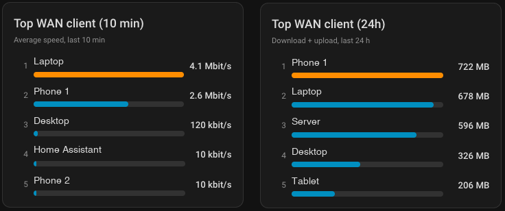
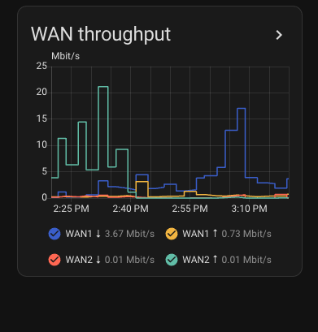

# Open Omada for Home Assistant

[](https://hacs.xyz/docs/faq/custom_repositories)
[](https://github.com/magnunscheffer/HA-Open-Omada/actions/workflows/validate.yml)
[](https://github.com/magnunscheffer/HA-Open-Omada/actions/workflows/tests.yml)

Community integration for **TP-Link Omada SDN** that uses the controller's **official Open API**
(`/openapi/…`, client credentials) instead of the internal web API.

> Community project, not affiliated with or endorsed by TP-Link. Omada is a trademark of TP-Link.
> Leia em português: [README.pt-BR.md](README.pt-BR.md)

## Why another Omada integration?

| | Open Omada | Core `tplink_omada` |
|---|---|---|
| API | Official Open API, client ID/secret | Internal web API, username/password (no 2FA) |
| Gateway ACLs, policy routes, port forwarding on/off | ✅ | — |
| SSIDs on/off | ✅ | — |
| Switch port on/off (same as the Omada UI) | ✅ | — |
| Active WAN (failover), WAN throughput/latency/loss | ✅ | link/online only |
| Per-WAN quality probes and automatic WAN failover/failback | ✅ | — |
| Top WAN clients (gateway DPI) + bundled dashboard card | ✅ | — |
| Reboot any device | ✅ | — |
| Client reconnect / block / unblock / rename | ✅ | reconnect, rename |
| PoE on/off and live PoE power | ✅ | ✅ |
| VPN on/off, WAN internet on/off, gateway LAN ports | ✅ | ✅ |
| Device status, CPU, memory, controller status | ✅ | ✅ |
| Wi-Fi presence (device tracker), firmware updates | — | ✅ |

## Requirements

- Omada Software Controller / OC200 / OC300 with Open API (tested on **6.3.0.45**)
- Home Assistant **2026.10** or newer

## Create the Open API application in Omada

1. Omada controller → **Global View → Settings → Platform Integration → Open API → Add New App**.
2. **Mode: Client**. Role: a *Viewer* role is enough for monitoring; switches, buttons and
   actions need a role that can modify the site (e.g. *Administrator*).
3. Copy the **Client ID** and **Client Secret**.

## Installation

### Via HACS (recommended)

[](https://my.home-assistant.io/redirect/hacs_repository/?owner=magnunscheffer&repository=HA-Open-Omada&category=integration)

The button above does steps 1–3 for you. Manually:

1. Make sure [HACS](https://hacs.xyz/docs/use/) is installed.
2. In Home Assistant open **HACS** → ⋮ (top right) → **Custom repositories**.
3. Repository: `https://github.com/magnunscheffer/HA-Open-Omada` — Type: **Integration** → **Add**.
4. Search HACS for **Open Omada** and open it.
5. Click **Download**, then **restart Home Assistant** (Settings → System → Restart).
6. Reload the browser page and add the integration (next section).

**Updating:** HACS shows an update when a new release is published; download it, restart Home
Assistant and reload the browser page.

### Manual

Copy `custom_components/open_omada` from the [latest release](https://github.com/magnunscheffer/HA-Open-Omada/releases)
into your `config/custom_components/` folder and restart Home Assistant.

## Configuration

[](https://my.home-assistant.io/redirect/config_flow_start/?domain=open_omada)

Or: **Settings → Devices & services → Add integration → Open Omada**

| Field | Description |
|---|---|
| URL | Controller address, e.g. `https://omada.local:8043` |
| Client ID / Client Secret | From the Open API application |
| Verify SSL certificate | Turn off for self-signed controller certificates |

Re-authentication and reconfiguration are supported from the integration page.

## Devices and entities

```
Omada Controller (service)   connected · devices count · one switch per SSID (attribute: access_points)
├─ Gateway                    online · CPU · memory · reboot · active WAN · top WAN client (10 min / 24 h)
│   ├─ per WAN               link · internet · in use · IP · download · upload · latency · loss
│   │                        internet connection switch*
│   ├─ per LAN port          link (PoE delivery on gateways with PoE)
│   └─ switches              ACLs · policy routes · port forwarding · VPNs
├─ Switch                     online · CPU · memory · reboot
│   └─ per port              enabled · link · PoE on/off · PoE power · PoE powering · speed*
└─ Access point               online · CPU · memory · reboot
```
\* disabled by default (also: uptime, port speed). The WAN internet connection switch is disabled on
purpose: turning off the WAN in use cuts the internet. Reconnecting a PPPoE WAN can take 30+ s and
may get a new public IP.

### Dashboard card: Open Omada · Top WAN

The integration ships its own card (no extra install, no manual resource). It shows the clients
using the most internet traffic as a bar ranking, read from the gateway DPI.



1. Edit a dashboard → **Add card** → search **Open Omada** → **Open Omada · Top WAN**.
2. The "Top WAN client" sensor is preselected; optionally change the title or the number of
   clients (1–5). Hover a row to see download/upload.

```yaml
type: custom:open-omada-top-wan-card
entity: sensor.<gateway>_top_wan_client_10_min   # or ..._24h
title: Top WAN usage   # optional
max: 5                 # optional, 1–5
display: auto          # optional: auto | rate | total
```

Two sensors feed it: **Top WAN client (10 min)** — shown as average speed (Mbit/s) — and
**Top WAN client (24h)** — shown as total (MB/GB). The gateway DPI aggregates traffic in ~5-minute
buckets, so 10 minutes is the closest to real time; 24 h fills up over the first day after DPI is
enabled.

DPI statistics reach the controller in batches that can arrive 30+ minutes late (there is no API
to force them). When a refresh comes back empty, the sensors keep their last result (attribute
`delayed: true`; `data_until` = time of that data) and the card shows
"10m - updated HH:MM · DPI delayed". After 30 minutes without new data the card says so.
Both windows refresh every minute.

After updating the integration, reload the browser page (Ctrl/⌘ + Shift + R) to get the new card.
Requires DPI enabled on the gateway.

### Example: WAN links with native cards

The per-WAN sensors work with Home Assistant's own cards. A history graph with the download/upload
of every link (sensors with different units get their own Y axis):



Replace `gateway` with the prefix of your gateway's entities (WAN entities follow the port names,
e.g. `WAN1` → `wan1`, `WAN/LAN2` → `wan_lan2`).

```yaml
type: history-graph
title: WAN throughput
hours_to_show: 1
entities:
  - entity: sensor.gateway_wan1_download
    name: WAN1 ↓
  - entity: sensor.gateway_wan1_upload
    name: WAN1 ↑
  - entity: sensor.gateway_wan_lan2_download
    name: WAN2 ↓
  - entity: sensor.gateway_wan_lan2_upload
    name: WAN2 ↑
```

Latency and status of the links:

```yaml
type: history-graph
title: WAN latency
hours_to_show: 6
entities:
  - entity: sensor.gateway_wan1_latency
    name: WAN1
  - entity: sensor.gateway_wan_lan2_latency
    name: WAN2
```

```yaml
type: glance
title: WAN status
entities:
  - entity: sensor.gateway_active_wan
    name: Active
  - entity: binary_sensor.gateway_wan1_internet
    name: WAN1
  - entity: binary_sensor.gateway_wan_lan2_internet
    name: WAN2
  - entity: binary_sensor.gateway_wan1_in_use
    name: WAN1 in use
  - entity: binary_sensor.gateway_wan_lan2_in_use
    name: WAN2 in use
```

The controller refreshes WAN rates about once a minute, which is also the integration's polling
interval.

### Actions

| Action | Fields |
|---|---|
| `open_omada.reconnect_client` | `mac` |
| `open_omada.block_client` | `mac` (Omada blocklist) |
| `open_omada.unblock_client` | `mac` |
| `open_omada.rename_client` | `mac`, `name` |

`config_entry_id` is only needed with more than one controller.

### How switches behave

- **Port on/off** works like the Omada UI: *off* applies the built-in **Disable** profile; *on*
  restores the profile the port had (remembered), or **All** if unknown.
- **PoE on/off** (controller ≥ 6.2.10 only allows it with profile override): *off* enables
  override on the port and turns PoE off; *on* turns PoE on and returns the port to its profile.
  Ports with **custom VLAN tagging** (trunks) are refused, because enabling override would need
  the VLAN lists, which the Open API does not return. Enable *Profile Override* on those ports in
  the Omada UI and the integration will only toggle PoE.
- ACLs, policy routes and port forwarding are updated by sending the full rule back with only
  `status` changed (the API has no status-only endpoint).

### Enhanced WAN Control (optional)

Measures the quality of **each** WAN with your own probe targets and can swap the primary and
backup WAN when the link in use goes bad. Turn it on in **Settings → Devices & services → Open
Omada → Configure**. It needs a gateway with two WANs in **failover** (link backup) mode.

**How probes are pinned to a WAN.** The integration creates and maintains these Omada objects,
all named `Open Omada probe <id> …`:

- an IP group with the Home Assistant host address;
- one IP group per WAN with that WAN's probe IPs;
- one policy route per WAN: Home Assistant → that WAN's probes → that WAN, with no fallback,
  kept at the **top** of the policy route list.

Only traffic from Home Assistant to the probe IPs is affected. The probe routes are not shown as
switches. Turning the feature off, or removing the integration, deletes these objects.

**Measurement** (same rules as the original script). Each probe is a TCP + TLS handshake on port
443, and its duration is the latency.

- **Offline:** no probe answers.
- **Poor:** fewer than a majority answer, or the median latency is above the threshold.
- **Good:** anything else.

A bad result is confirmed with extra tests before it counts.

**Failover** (select *Auto WAN failover*):

- `off`: measure only.
- `notify` (default): changes nothing. It creates a persistent notification, which stays until you
  dismiss it, and fires the `open_omada_wan_failover` event with `dry_run: true`.
- `automatic`: swaps the primary and backup WAN when the WAN in use is Poor or Offline and the
  other one is Good.

It returns to the *Preferred WAN* only after that WAN has been Good for the failback time
**in a row**: any non-Good result restarts the count. A minimum time between switches avoids
flapping.

| Option | Default |
|---|---|
| Probes for WAN port 1 | `9.9.9.9, nic.br, ec2.sa-east-1.amazonaws.com` |
| Probes for WAN port 2 | `149.112.112.112, iaas.sa-saopaulo-1.oraclecloud.com, 8.8.4.4` |
| Poor above median latency | 150 ms |
| Measure every | 30 s |
| Extra tests to confirm a bad result / seconds between them | 2 / 5 s |
| Minimum minutes between switches | 15 |
| Return to the preferred WAN after it is good for | 60 min |

Entities on the gateway:

- per WAN: *Quality* (with per-probe attributes), *Probe latency*, *Probe jitter*, *Probes OK*;
- *WAN failover* status (`ok`, `failed_over`, `cooldown`, `monitoring`, `error`);
- selects *Auto WAN failover*, *Preferred WAN* and *Primary WAN*. *Primary WAN* swaps the roles
  right away.

The `open_omada_wan_failover` event carries `from`, `to`, `reason` and `dry_run`. Use it in an
automation to get a notification.

> **Do not use a WAN's DNS servers as probes.** The gateway routes traffic to the DNS servers set
> on its WANs itself, ignoring policy routes. A probe on such an IP cannot be pinned. It is
> skipped and listed in the `skipped_probes` attribute of the *Quality* sensor. For example,
> `1.1.1.1` as the PPPoE DNS of WAN1 left through WAN2.

## Data updates

One coordinated poll every **60 s** (requests are serialised to protect the controller). The DPI
"Top WAN client" sensors (10 min and 24 h windows) also refresh every 60 s; when the controller has
no new DPI batch yet, the previous result is kept for up to 30 min (`delayed`). Enhanced WAN
Control measures on its own interval (30 s by default).

## Known limitations

- **Public IP per WAN** is not exposed by the Open API. When a WAN gets a private address (modem,
  CGNAT) only that address is available.
- **Top WAN clients** need **DPI** enabled on the gateway (Omada → Network Security → Application
  Control). Per-client traffic without DPI includes LAN traffic, so it is not used.
- **Enhanced WAN Control** handles two WANs in failover mode (not load balancing or 3+ WANs).
- PoE "powering" status depends on what the controller reports for each switch model.
- Do not download the API docs from the controller itself (`/v3/api-docs`): generating them can
  hang the controller. Use TP-Link's published copy.

## Troubleshooting

- **Card shows "Custom element doesn't exist" or the card picker keeps spinning:** the page was
  loaded before Home Assistant finished starting the integration (e.g. right after a restart), or
  the browser kept an old copy. Reload the page (Ctrl/⌘ + Shift + R).

- Download **diagnostics** from the integration page (secrets, MACs and IPs are redacted).
- Debug logging:
  ```yaml
  logger:
    logs:
      custom_components.open_omada: debug
  ```

## Removal

Remove the integration from **Settings → Devices & services**, then (optionally) delete the Open
API application in Omada. Uninstall from HACS.

## Development

```bash
python3.14 -m venv .venv && .venv/bin/pip install -r requirements-dev.txt
.venv/bin/pytest -q && .venv/bin/ruff check .              # API layer
python3.14 -m venv .venv-test && .venv-test/bin/pip install pytest-homeassistant-custom-component
.venv-test/bin/python -m pytest tests/integration -q        # HA integration
cp .env.example .env && .venv/bin/python scripts/omada_query.py   # live read-only dump
```

`scripts/omada_query.py --json` prints MAC/IP addresses and serial numbers of your network; add
`--redact` before sharing the output (device and host names are kept).

The `custom_components/open_omada/api/` package has no Home Assistant dependency. Endpoint notes
and the list of write paths validated on real hardware: [docs/api-reference.md](docs/api-reference.md).

## License

[MIT](LICENSE)
