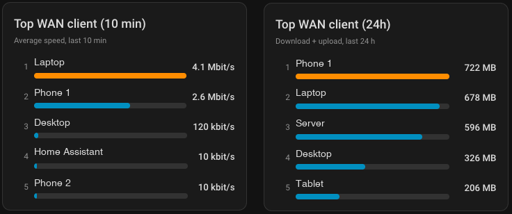

# Open Omada para Home Assistant

Integração da comunidade para **TP-Link Omada SDN** usando a **Open API oficial** do controller
(`/openapi/…`, client credentials), e não a Web API interna.

> Projeto da comunidade, sem vínculo com a TP-Link. Omada é marca registrada da TP-Link.
> English: [README.md](README.md)

## Requisitos

- Omada Software Controller / OC200 / OC300 com Open API (testado na **6.3.0.45**)
- Home Assistant **2026.10** ou mais novo

## Criar o aplicativo Open API no Omada

1. **Global View → Settings → Platform Integration → Open API → Add New App**.
2. **Mode: Client**. Papel *Viewer* basta para monitorar; switches, botões e ações exigem um
   papel com permissão de alteração no site (ex.: *Administrator*).
3. Copie o **Client ID** e o **Client Secret**.

## Instalação

**HACS (repositório customizado):** HACS → ⋮ → **Custom repositories** →
`https://github.com/magnunscheffer/HA-Open-Omada`, categoria **Integration**. Instale **Open Omada**,
reinicie o HA e recarregue a página do navegador.

**Manual:** copie `custom_components/open_omada` para `config/custom_components/` e reinicie.

## Configuração

**Configurações → Dispositivos e serviços → Adicionar integração → Open Omada**: URL do controller
(ex.: `https://omada.local:8043`), Client ID, Client Secret e "Verificar certificado SSL" (desligue
para certificado autoassinado). Reautenticação e reconfiguração ficam na página da integração.

## Dispositivos e entidades

```
Omada Controller (serviço)   total de devices · um switch por SSID (atributo: access_points)
├─ Gateway                    online · CPU · memória · reboot · WAN ativa · maior consumo de WAN
│   ├─ por WAN               link · internet · em uso · IP · download · upload · latência · perda
│   └─ switches              ACLs · policy routes · port forwarding
├─ Switch                     online · CPU · memória · reboot
│   └─ por porta             habilitada · link · PoE on/off · potência PoE · alimentando · velocidade*
└─ Access point               online · CPU · memória · reboot
```
\* desabilitado por padrão (assim como uptime).

### Card do dashboard: Open Omada · Top WAN

A integração já traz um card próprio (sem instalar nada a mais, sem registrar recurso). Ele mostra
os clientes que mais usam internet, em barras, a partir do DPI do gateway.



1. Edite um painel → **Adicionar card** → busque **Open Omada** → **Open Omada · Top WAN**.
2. O sensor "Top WAN client" já vem selecionado; ajuste o título ou a quantidade (1–5) se quiser.
   Passe o mouse numa linha para ver download/upload.

```yaml
type: custom:open-omada-top-wan-card
entity: sensor.<gateway>_top_wan_client_10_min   # ou ..._24h
```

Dois sensores alimentam o card: **Top WAN client (10 min)**, mostrado como velocidade média
(Mbit/s), e **Top WAN client (24h)**, mostrado como total (MB/GB). O DPI agrupa o tráfego em blocos
de ~5 minutos, então 10 minutos é o mais próximo de tempo real; as 24 h se completam no primeiro dia
após ligar o DPI.

As estatísticas do DPI chegam ao controller em lotes que podem atrasar mais de 30 minutos (não há
API para forçar o envio). Quando uma coleta vem vazia, os sensores mantêm o último resultado
(atributo `delayed: true`; `data_until` = horário desses dados) e o card mostra
"10m - updated HH:MM · DPI delayed". Depois de 30 minutos sem dados novos, o card avisa. As duas
janelas são consultadas a cada minuto.

Depois de atualizar a integração, recarregue a página do navegador (Ctrl/⌘ + Shift + R). Exige DPI
ligado no gateway.

### Exemplo: links de WAN com cards nativos

Os sensores de cada WAN funcionam com os cards do próprio HA. Gráfico de histórico com download e
upload de cada link (unidades diferentes ganham eixos Y próprios):


Troque `gateway` pelo prefixo das entidades do seu gateway (as WANs seguem o nome da porta, ex.:
`WAN1` → `wan1`, `WAN/LAN2` → `wan_lan2`).

```yaml
type: history-graph
title: WAN throughput
hours_to_show: 1
entities:
  - entity: sensor.gateway_wan1_download
    name: WAN1 ↓
  - entity: sensor.gateway_wan1_upload
    name: WAN1 ↑
  - entity: sensor.gateway_wan_lan2_download
    name: WAN2 ↓
  - entity: sensor.gateway_wan_lan2_upload
    name: WAN2 ↑
```

Latência e status dos links: veja os exemplos `WAN latency` e `WAN status` no [README em inglês](README.md#example-wan-links-with-native-cards).

O controller atualiza as taxas das WANs cerca de uma vez por minuto, o mesmo intervalo de leitura
da integração.

**Ações:** `open_omada.reconnect_client`, `open_omada.block_client`, `open_omada.unblock_client`
(campo `mac`) e `open_omada.rename_client` (`mac`, `name`).

Também: status das portas LAN do gateway, "Connected" do controller, switch por VPN e switch de
conexão de internet por WAN (**desabilitado por padrão**: desligar a WAN em uso derruba a internet;
religar uma WAN PPPoE pode levar 30+ s e trocar o IP público).

### Como os switches funcionam

- **Porta on/off** igual à interface do Omada: *off* aplica o profile **Disable**; *on* volta ao
  profile anterior (memorizado) ou **All** se desconhecido.
- **PoE on/off** (no controller ≥ 6.2.10 só com profile override): *off* ativa o override e desliga
  o PoE; *on* religa o PoE e devolve a porta ao profile. Portas com **tags de VLAN personalizadas**
  (trunks) são recusadas: ativar o override exigiria a lista de VLANs, que a Open API não devolve.
  Ative o *Profile Override* dessas portas na console e a integração passa a só ligar/desligar PoE.
- ACLs, policy routes e port forwarding: a regra inteira é reenviada mudando só o `status`.

### Enhanced WAN Control (opcional)

📘 **Guia completo (em inglês):** [docs/enhanced-wan-control.md](docs/enhanced-wan-control.md). Explica como funciona, como escolher as sondas, automações, testes e solução de problemas.

Mede a qualidade de **cada** WAN com sondas definidas por você e pode inverter WAN primária e
backup quando o link em uso piora. Ative em **Configurações → Dispositivos e serviços → Open Omada
→ Configurar**. Exige gateway com duas WANs em modo **failover** (link backup) e foi testado com um único gateway
num único site (veja [Limitações conhecidas](#limitações-conhecidas)).

**Configuração recomendada no Omada** (*Internet → Load Balancing*):

| Configuração | Recomendado | Por quê |
|---|---|---|
| Link Backup | **Enable** | Obrigatório: uma WAN primária e uma backup |
| Recover Mode | **Always Link Primary** | Depois de uma queda tratada pelo próprio gateway, o tráfego volta para a primária. Com *Link Backup* ele fica na backup, e a integração não consegue trazê-lo de volta |
| Failover Mode | **Any primary WAN fails** (*all* dá no mesmo com uma primária só) | Não use *Timing*: a integração não consegue saber qual WAN está em uso |
| Online Detection | **Ligada nas duas WANs** | O gateway troca sozinho quando uma WAN perde a internet, e a integração usa isso para saber qual WAN está em uso |

O gateway cuida das quedas de vez. A integração também pega internet ruim (latência, perda) e muda
qual WAN é a primária. Se o gateway já desviou o tráfego, a integração não faz nada e mostra
`failed_over`.

**Como as sondas são fixadas em cada WAN.** A integração cria e mantém estes objetos no Omada, todos
com nome `Open Omada probe <id> …`:

- um grupo de IP com o endereço do Home Assistant;
- um grupo de IP por WAN com os IPs das sondas daquela WAN;
- uma policy route por WAN (Home Assistant → sondas daquela WAN → aquela WAN, sem fallback),
  mantida no **topo** da lista.

Só o tráfego do Home Assistant para os IPs das sondas é afetado. As rotas das sondas não aparecem
como switches. Desativar o recurso, ou remover a integração, apaga esses objetos.

**Sondas por WAN:** de 1 a 10. Use **3 ou mais**, e número ímpar é melhor: com uma sonda só, um
destino fora do ar faz a WAN inteira parecer ruim. Quando sobram menos de 3 sondas válidas, aparece
um aviso em **Configurações → Reparos**. Sondas que são DNS de uma WAN ou que não resolvem são
ignoradas.

**Medição** (mesmas regras do script original). Cada sonda é um handshake TCP + TLS na porta 443,
e a duração dele é a latência.

- **Offline:** nenhuma sonda responde.
- **Poor:** menos da maioria responde, ou a latência mediana passa do limite.
- **Good:** qualquer outro caso.

Um resultado ruim é confirmado com testes extras antes de contar.

**Failover** (select *Auto WAN failover*):

- `off`: só mede.
- `notify` (padrão): não muda nada. Cria uma notificação persistente, que fica até você dispensar,
  e dispara o evento `open_omada_wan_failover` com `dry_run: true`.
- `automatic`: inverte primária e backup quando a WAN em uso está Poor ou Offline e a outra está
  Good.

A volta para a *Preferred WAN* só acontece depois que ela fica Good pelo tempo de failback **sem
interrupção**: qualquer resultado diferente de Good zera a contagem. Um intervalo mínimo entre
trocas evita oscilação.

| Opção | Padrão |
|---|---|
| Sondas da WAN na porta 1 | `9.9.9.9, nic.br, ec2.sa-east-1.amazonaws.com` |
| Sondas da WAN na porta 2 | `149.112.112.112, iaas.sa-saopaulo-1.oraclecloud.com, 8.8.4.4` |
| Seção *Qualidade*: Poor acima da latência mediana | 150 ms |
| Medir a cada | 30 s |
| Testes extras para confirmar / intervalo entre eles | 2 / 5 s |
| Seção *Failover*: minutos mínimos entre trocas | 15 |
| Voltar à WAN preferida depois de boa por | 60 min |

Entidades no gateway:

- por WAN: *Quality* (com atributos por sonda), *Probe latency*, *Probe jitter*, *Probes OK*;
- status *WAN failover* (`ok`, `failed_over`, `cooldown`, `monitoring`, `error`);
- *Last WAN switch*: quando a integração mudou a WAN primária pela última vez, com `from`, `to`,
  `reason` e `trigger` (`automatic` ou `manual`). Sobrevive a reinícios. Sugestões do modo Notify
  não contam;
- selects *Auto WAN failover*, *Preferred WAN* e *Primary WAN*. *Primary WAN* troca os papéis na
  hora.

O evento `open_omada_wan_failover` traz `from`, `to`, `reason` e `dry_run`. Use-o numa automação
para receber notificação.

> **Não use como sonda os servidores DNS configurados numa WAN.** O gateway roteia por conta própria
> o tráfego para os DNS das WANs, ignorando as policy routes. Uma sonda nesse IP não pode ser
> fixada: ela é ignorada e listada no atributo `skipped_probes` do sensor *Quality*. Exemplo:
> `1.1.1.1` como DNS do PPPoE da WAN1 saía pela WAN2.

## Limitações conhecidas

- A Open API **não informa o IP público de cada WAN**; atrás de modem/CGNAT só há o IP privado.
- **Maior consumo de WAN** exige **DPI** ligado no gateway (Network Security → Application Control).
- O **Enhanced WAN Control** trata duas WANs em failover (não balanceamento nem 3+ WANs). Foi
  testado com **um único gateway num único site**: com vários sites ou gateways, só o primeiro site
  que tiver um gateway com duas WANs é controlado, e pode não funcionar como esperado.
- Não baixe a documentação da API do próprio controller (`/v3/api-docs`): pode travá-lo.

## Problemas

- **Card mostra "Custom element doesn't exist" ou a lista de cards fica girando:** a página foi
  aberta antes do HA terminar de iniciar a integração (logo após um reinício) ou o navegador ficou
  com uma cópia antiga. Recarregue a página (Ctrl/⌘ + Shift + R).
- **Mesmo erro no app do Home Assistant (celular/tablet):** o app guarda o frontend em cache por
  mais tempo que o navegador. Limpe o cache e depois feche e abra o app:
  - **iPhone/iPad:** *Configurações → Companion App → Debug → Clear web view cache*;
  - **Android:** *Configurações → Companion App → Troubleshooting → Reset frontend cache*.

Baixe os **diagnósticos** na página da integração (segredos, MACs e IPs mascarados) e ative o log
`custom_components.open_omada: debug`.

## Licença

[MIT](LICENSE)
