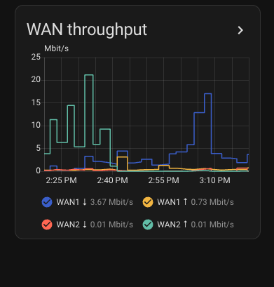

# Open Omada para Home Assistant

Integração da comunidade para **TP-Link Omada SDN** usando a **Open API oficial** do controller
(`/openapi/…`, client credentials), e não a Web API interna.

> Projeto da comunidade, sem vínculo com a TP-Link. Omada é marca registrada da TP-Link.
> English: [README.md](README.md)

## Requisitos

- Omada Software Controller / OC200 / OC300 com Open API (testado na **6.3.0.45**)
- Home Assistant **2026.10** ou mais novo

## Criar o aplicativo Open API no Omada

1. **Global View → Settings → Platform Integration → Open API → Add New App**.
2. **Mode: Client**. Papel *Viewer* basta para monitorar; switches, botões e ações exigem um
   papel com permissão de alteração no site (ex.: *Administrator*).
3. Copie o **Client ID** e o **Client Secret**.

## Instalação

**HACS (repositório customizado):** HACS → ⋮ → **Custom repositories** →
`https://github.com/magnunscheffer/HA-Open-Omada`, categoria **Integration**. Instale **Open Omada**,
reinicie o HA e recarregue a página do navegador.

**Manual:** copie `custom_components/open_omada` para `config/custom_components/` e reinicie.

## Configuração

**Configurações → Dispositivos e serviços → Adicionar integração → Open Omada**: URL do controller
(ex.: `https://omada.local:8043`), Client ID, Client Secret e "Verificar certificado SSL" (desligue
para certificado autoassinado). Reautenticação e reconfiguração ficam na página da integração.

## Dispositivos e entidades

```
Omada Controller (serviço)   total de devices · um switch por SSID (atributo: access_points)
├─ Gateway                    online · CPU · memória · reboot · WAN ativa · maior consumo de WAN
│   ├─ por WAN               link · internet · em uso · IP · download · upload · latência · perda
│   └─ switches              ACLs · policy routes · port forwarding
├─ Switch                     online · CPU · memória · reboot
│   └─ por porta             habilitada · link · PoE on/off · potência PoE · alimentando · velocidade*
└─ Access point               online · CPU · memória · reboot
```
\* desabilitado por padrão (assim como uptime).

### Card do dashboard: Open Omada · Top WAN

A integração já traz um card próprio (sem instalar nada a mais, sem registrar recurso). Ele mostra
os clientes que mais usam internet, em barras, a partir do DPI do gateway.


1. Edite um painel → **Adicionar card** → busque **Open Omada** → **Open Omada · Top WAN**.
2. O sensor "Top WAN client" já vem selecionado; ajuste o título ou a quantidade (1–5) se quiser.
   Passe o mouse numa linha para ver download/upload.

```yaml
type: custom:open-omada-top-wan-card
entity: sensor.<gateway>_top_wan_client_10_min   # ou ..._24h
```

Dois sensores alimentam o card: **Top WAN client (10 min)**, mostrado como velocidade média
(Mbit/s), e **Top WAN client (24h)**, mostrado como total (MB/GB). O DPI agrupa o tráfego em blocos
de ~5 minutos, então 10 minutos é o mais próximo de tempo real; as 24 h se completam no primeiro dia
após ligar o DPI.

As estatísticas do DPI chegam ao controller em lotes que podem atrasar mais de 30 minutos (não há
API para forçar o envio). Quando os últimos 10 minutos ainda não chegaram, o sensor usa os 10
minutos mais recentes disponíveis (até 1 h atrás): atributos `delayed: true` e `data_until`, e o
card mostra "…until HH:MM (DPI data is delayed)".

Depois de atualizar a integração, recarregue a página do navegador (Ctrl/⌘ + Shift + R). Exige DPI
ligado no gateway.

### Exemplo: links de WAN com cards nativos

Os sensores de cada WAN funcionam com os cards do próprio HA. Gráfico de histórico com download e
upload de cada link (unidades diferentes ganham eixos Y próprios):



Troque `gateway` pelo prefixo das entidades do seu gateway (as WANs seguem o nome da porta, ex.:
`WAN1` → `wan1`, `WAN/LAN2` → `wan_lan2`).

```yaml
type: history-graph
title: WAN throughput
hours_to_show: 1
entities:
  - entity: sensor.gateway_wan1_download
    name: WAN1 ↓
  - entity: sensor.gateway_wan1_upload
    name: WAN1 ↑
  - entity: sensor.gateway_wan_lan2_download
    name: WAN2 ↓
  - entity: sensor.gateway_wan_lan2_upload
    name: WAN2 ↑
```

Latência e status dos links: veja os exemplos `WAN latency` e `WAN status` no [README em inglês](README.md#example-wan-links-with-native-cards).

O controller atualiza as taxas das WANs cerca de uma vez por minuto, o mesmo intervalo de leitura
da integração.

**Ações:** `open_omada.reconnect_client`, `open_omada.block_client`, `open_omada.unblock_client`
(campo `mac`).

### Como os switches funcionam

- **Porta on/off** igual à interface do Omada: *off* aplica o profile **Disable**; *on* volta ao
  profile anterior (memorizado) ou **All** se desconhecido.
- **PoE on/off** (no controller ≥ 6.2.10 só com profile override): *off* ativa o override e desliga
  o PoE; *on* religa o PoE e devolve a porta ao profile. Portas com **tags de VLAN personalizadas**
  (trunks) são recusadas: ativar o override exigiria a lista de VLANs, que a Open API não devolve.
  Ative o *Profile Override* dessas portas na console e a integração passa a só ligar/desligar PoE.
- ACLs, policy routes e port forwarding: a regra inteira é reenviada mudando só o `status`.

## Limitações conhecidas

- A Open API **não informa o IP público de cada WAN**; atrás de modem/CGNAT só há o IP privado.
- **Maior consumo de WAN** exige **DPI** ligado no gateway (Network Security → Application Control).
- Não baixe a documentação da API do próprio controller (`/v3/api-docs`): pode travá-lo.

## Problemas

- **Card mostra "Custom element doesn't exist" ou a lista de cards fica girando:** a página foi
  aberta antes do HA terminar de iniciar a integração (logo após um reinício) ou o navegador ficou
  com uma cópia antiga. Recarregue a página (Ctrl/⌘ + Shift + R).

Baixe os **diagnósticos** na página da integração (segredos, MACs e IPs mascarados) e ative o log
`custom_components.open_omada: debug`.

## Licença

[MIT](LICENSE)
