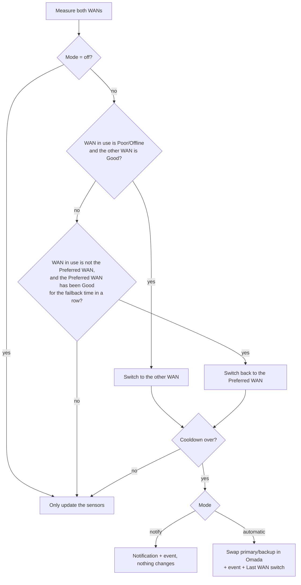

# Enhanced WAN Control

Enhanced WAN Control watches the quality of **each** internet link on an Omada gateway. When the
link in use goes bad, it can make the other link the primary one. It is optional and turned off by
default.

## Why use it

The gateway's own failover reacts when a WAN goes **down**: the cable is unplugged, or Online
Detection fails, if you set it up. It does not react when the link stays **up** but the internet
behind it is dead or bad. Typical cases:

- the ISP's fiber or coax is down, but the modem is still on;
- the ISP has an outage further upstream;
- the link is congested or has very high latency.

Enhanced WAN Control measures real connections through each WAN. It can then:

- tell you (**notify** mode);
- or swap the primary and backup WAN for you (**automatic** mode).

## Requirements

- A gateway with **two WANs** in **failover** mode (Omada: *Internet → Load Balancing → Link
  Backup*), with one primary WAN and one backup WAN.
- Open Omada **1.2.0** or later.
- The Open API application needs admin rights, because the integration creates IP groups and policy
  routes.
- Run it on **one** Home Assistant instance per controller. Two instances would each switch the
  WANs and work against each other.

Tested with **one gateway in one site**. With several sites or gateways, only the first site
that has a gateway with two WANs is controlled, and it may not work as expected.

## How it works

### 1. Probes are pinned to a WAN

A probe is a host name or IPv4 address that is measured through one specific WAN. To make sure a
probe really leaves through that WAN, the integration creates these Omada objects. They are all
named `Open Omada probe <id> …`, where `<id>` identifies this Home Assistant instance:

| Object | Content |
|---|---|
| IP group `… HA` | The Home Assistant host address |
| IP group `… WAN1`, `… WAN2` | The probe IPs of each WAN |
| Policy route `… WAN1`, `… WAN2` | From Home Assistant to that WAN's probes, through that WAN, **with no fallback** |

- **Order:** the probe routes are kept at the **top** of the policy route list, so your own routes
  cannot override them.
- **Scope:** only traffic from Home Assistant to the probe IPs uses these routes. Everything else is
  untouched.
- **No fallback:** if a WAN is down, its probes fail instead of sneaking out through the other WAN.
  This keeps the measurement honest.
- **Maintenance:** the objects are checked again every hour. Deleted objects are recreated, host
  names are resolved again, and the routes are moved back to the top.
- **Hidden:** the probe routes do not show up as policy route switches in Home Assistant.
- **Removal:** turning the feature off, or removing the integration, deletes all of these objects.

### 2. Each WAN is measured

Every *measure interval* (30 s by default), all probes of both WANs run in parallel. A probe is a
TCP connection plus a TLS handshake on port 443. No data is sent, and the time it takes is the
latency. Each WAN then gets one of these grades:

| Quality | When |
|---|---|
| **Good** | A majority of the probes answer, and the median latency is at or below the limit |
| **Poor** | Fewer than a majority answer, or the median latency is above the limit (150 ms by default) |
| **Offline** | No probe answers |

A Poor or Offline result is **confirmed** before it counts. The integration runs extra tests (2 by
default, 5 s apart) and takes the majority of all results. This keeps a single lost packet from
causing a switch.

"Majority" means `probes ÷ 2 + 1`, rounded down. With 3 probes, 2 must answer. With 5 probes,
3 must answer.

### 3. The decision



- **Failover:** the WAN in use is Poor or Offline and the other WAN is Good, so the integration
  switches to the other WAN. If **both** are bad, nothing happens.
- **Failback:** the integration returns to the *Preferred WAN* only after it has been **Good for
  the whole failback time in a row** (60 min by default). **Any** result that is not Good restarts
  the count.
- **Cooldown:** after any switch, automatic or manual, no automatic switch happens for the
  cooldown time (15 min by default). This prevents flapping.
- **Switching:** the integration swaps the *primary* and *backup* roles in Omada's load-balance
  settings. Everything else stays the same. Traffic usually moves within about 20 s.

### Example (Preferred WAN = WAN2, automatic mode)

| Time | What happens |
|---|---|
| 10:00 | WAN2's ISP has an outage. WAN2 is *Offline* after confirmation, and WAN1 is *Good* |
| 10:00 | The integration makes WAN1 primary. Status shows `cooldown`, then `failed_over` |
| 10:20 | WAN2 is back and the failback count starts |
| 10:50 | WAN2 has one *Poor* result and the count restarts |
| 11:51 | WAN2 has been *Good* for 60 min in a row, so the integration switches back. Status shows `ok` |

## Setting it up

1. Go to **Settings → Devices & services → Open Omada → Configure**.
2. Turn on **Enable Enhanced WAN Control**.
3. Enter the **probes** for each WAN. The fields are labeled with your WAN names.
4. Optionally, adjust the **Quality** and **Failover** sections.
5. Submit. The Omada objects are created right away.
6. On the gateway device, check the **Preferred WAN** select. The first time, it takes the WAN that
   is primary at that moment. Set it to the WAN you want to normally use.
7. Leave **Auto WAN failover** on `notify` for a while, and switch it to `automatic` once the
   suggestions look right.

### Options

| Option | Default | Meaning |
|---|---|---|
| Probes for each WAN | see below | 1 to 10 host names or IPv4 addresses, comma separated |
| Poor above median latency | 150 ms | Latency limit for *Poor* |
| Measure every | 30 s | How often both WANs are measured |
| Extra tests to confirm a bad result | 2 | Confirmation tests before Poor or Offline counts |
| Seconds between confirmation tests | 5 s | |
| Minimum minutes between switches | 15 | Cooldown |
| Return to the preferred WAN after it is good for | 60 min | Failback time, in a row |

### Choosing probes

The defaults combine a public DNS anycast address with two large, nearby services for each WAN:

- WAN 1: `9.9.9.9, nic.br, ec2.sa-east-1.amazonaws.com`
- WAN 2: `149.112.112.112, iaas.sa-saopaulo-1.oraclecloud.com, 8.8.4.4`

The host names in the defaults are in Brazil. Pick services close to you.

Guidelines:

- **Use 3 or more per WAN, and an odd number works best.** With a single probe, one target that is
  down makes the whole WAN look bad. When fewer than 3 usable probes remain, a warning appears in
  **Settings → Repairs**.
- **Every probe must accept HTTPS (port 443).**
- **A probe can only be used on one WAN.** One IP can only be pinned to one WAN.
- **Do not use the DNS servers set on a WAN.** The gateway routes its own WAN DNS servers itself,
  ignoring policy routes, so such a probe cannot be pinned. For example, with `1.1.1.1` set as the
  PPPoE DNS of WAN1, probes to `1.1.1.1` left through WAN2. The options form lists your WAN DNS
  servers, and such probes are skipped and listed in the `skipped_probes` attribute.
- **Host names are resolved** when the objects are synced (every hour), and the first IPv4 address
  is used. A host name that does not resolve is skipped.

## Entities

All of them are on the **gateway** device.

| Entity | Description |
|---|---|
| *&lt;WAN&gt; quality* | `good`, `poor`, `offline` or `unknown`. Attributes: `probes` (each probe's `host`, `ip`, `ok`, `latency_ms`, `error`), `stable_minutes`, `samples`, `updated`, `skipped_probes` |
| *&lt;WAN&gt; probe latency* | Median probe latency (ms) |
| *&lt;WAN&gt; probe jitter* | Spread of the probe latencies (ms) |
| *&lt;WAN&gt; probes OK* | Share of probes that answered (%) |
| *WAN failover* | `ok`, `failed_over`, `cooldown`, `monitoring` (mode off) or `error`. Attributes: `mode`, `wan_in_use`, `preferred_wan`, `preferred_stable_minutes`, `failback_after_minutes`, `cooldown_left_minutes`, `last_action`, `error` |
| *Last WAN switch* | When the integration last changed the primary WAN. Attributes: `from`, `to`, `reason`, `trigger` (`automatic` or `manual`). Kept across restarts. Suggestions in notify mode do not count |
| *Auto WAN failover* (select) | `off`, `notify` or `automatic` |
| *Preferred WAN* (select) | The WAN to return to |
| *Primary WAN* (select) | The primary WAN in Omada right now. Choosing the other one swaps the roles **immediately** |

> **A manual switch is temporary in automatic mode.** If you pick a WAN in *Primary WAN* but leave
> *Preferred WAN* unchanged, the integration switches back once the preferred WAN has been Good for
> the failback time. To make the change last, change *Preferred WAN* too.

## Notifications and automations

- **Notify mode** creates a persistent notification, *"Open Omada: WAN failover suggested"*. It
  stays until you dismiss it, and a new suggestion replaces the old one.
- **Both modes** fire the `open_omada_wan_failover` event with `from`, `to`, `reason` and
  `dry_run`. `dry_run` is `true` for a notify-mode suggestion and `false` for a real switch.

Example automation that sends a phone notification:

```yaml
automation:
  - alias: "WAN failover"
    triggers:
      - trigger: event
        event_type: open_omada_wan_failover
    actions:
      - action: notify.mobile_app_my_phone
        data:
          title: >-
            {{ 'WAN failover suggested' if trigger.event.data.dry_run else 'WAN switched' }}
          message: >-
            {{ trigger.event.data.from }} → {{ trigger.event.data.to }}: {{ trigger.event.data.reason }}
```

To react to **any** WAN change, including the gateway's own failover, trigger on the *Active WAN*
sensor instead.

## Testing it safely

- Leave the mode on `notify` first.
- To simulate an outage, disconnect the **ISP side** of the modem (fiber, coax or DSL) and leave
  the Ethernet cable to the gateway connected. If you unplug the gateway cable instead, Omada's own
  failover takes over, and you are not testing Enhanced WAN Control.
- Remember that if the WAN you take down is the one in use and nothing switches, your network has
  no internet until you reconnect it.
- Watch *&lt;WAN&gt; quality*, *WAN failover* and *Last WAN switch*. Only a real switch updates
  *Last WAN switch*.

## Troubleshooting

| Symptom | Check |
|---|---|
| A WAN shows *Poor* although it works | Raise the latency limit. Check the `probes` attribute for a target that is slow or down, and replace it |
| A probe never answers | It must accept HTTPS on port 443. Some hosts block it |
| `skipped_probes` is not empty | The probe is a WAN DNS server or did not resolve. Choose another one |
| Warning in **Repairs** | Fewer than 3 usable probes for a WAN. Add probes |
| *WAN failover* shows `error` | See its `error` attribute and the log (`custom_components.open_omada`). A common cause is a gateway that is not in failover mode with two WANs |
| No switch although a WAN is bad | The mode must be `automatic`, the other WAN must be *Good*, and the cooldown must be over |
| It switched back too early or too late | Adjust the failback time. Any non-Good result restarts the count |

Debug logging:

```yaml
logger:
  logs:
    custom_components.open_omada: debug
```

## Limitations

- Two WANs in failover mode only. Load balancing and three or more WANs are not supported.
- Tested with one gateway in one site (see [Requirements](#requirements)).
- Probes measure from the Home Assistant host. If that host's own network has problems, both WANs
  can look bad. In that case nothing switches.
- Only IPv4 probes.
